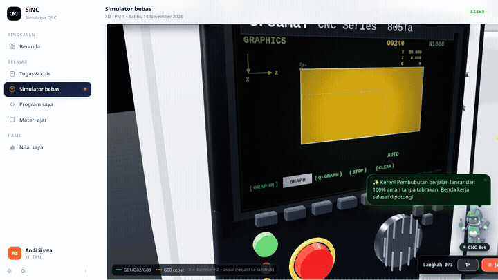
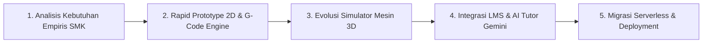
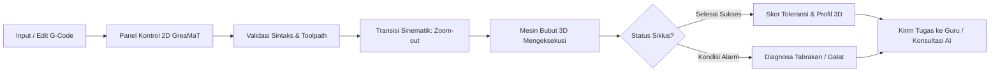

# SiNC: Simulator Bubut CNC

<p align="center">
  <strong>Belajar Pemrograman CNC melalui Simulasi Interaktif dan Pendampingan Digital</strong>
  <br />
  <em>Platform pembelajaran berbasis web untuk membantu siswa memahami G-Code bubut CNC secara visual, bertahap, dan terukur.</em>
</p>

<p align="center">
  
  
  
  
  
  
</p>

Learning Management System (LMS) G-Code untuk SMK berbasis **Full Serverless** yang menggabungkan kelas virtual, simulator mesin bubut CNC 3D interaktif, dan asisten cerdas **Google Gemini AI**.

🌐 **Demo Live Web:** [https://fatafavian.github.io/SiNC/](https://fatafavian.github.io/SiNC/)  
🎬 **Video Demonstrasi Penuh:** [Tonton Langsung Video Demonstrasi MP4](https://fatafavian.github.io/SiNC/docs/demo-sinc.mp4)

[](https://fatafavian.github.io/SiNC/docs/demo-sinc.mp4)

> ▶️ **[Klik gambar di atas atau klik di sini untuk memutar Video Demonstrasi Lengkap](https://fatafavian.github.io/SiNC/docs/demo-sinc.mp4)**  
> *Rekaman video memperlihatkan alur kerja komprehensif 3 peran pengguna: Siswa (eksplorasi materi, pemotongan bubut 3D, inspeksi 360°, AI CNC-Bot, alarm tabrakan), Guru Pengampu (manajemen kelas, penugasan jobsheet, pustaka modul), dan Administrator (statistik KBM, manajemen akun, pengaturan rombel).*

---

## 1. Tentang SiNC

**SiNC (Simulator CNC)** adalah platform Learning Management System (LMS) terpadu yang mengintegrasikan simulator bubut CNC interaktif dengan aktivitas pembelajaran vokasi. Aplikasi ini dirancang sebagai jembatan praktis dalam pembelajaran pemrograman CNC, khususnya pengenalan, perancangan, dan verifikasi kode G-Code mesin bubut.

SiNC dikembangkan dalam rangka kompetisi **LOGICODIX 2026** dengan subtema **Smart & Fun Education**, berfokus pada penghapusan sekat antara teori di buku teks dan praktik nyata di bengkel permesinan.

---

## 2. Latar Belakang dan Permasalahan

### Latar Belakang Empiris
Gagasan pengembangan SiNC berakar langsung dari pengalaman empiris tim saat menempuh pendidikan di **SMK Jurusan Teknik Pemesinan**. Pada pembelajaran mesin bubut CNC konvensional, sekolah kerap menghadapi keterbatasan sarana fasilitas fisik yang nyata:
- **Kesenjangan Rasio Fasilitas**: Di bengkel sekolah, umumnya hanya tersedia **2 unit mesin bubut CNC fisik untuk melayani sekitar 30 siswa** dalam satu rombongan belajar.
- **Minimnya Waktu Praktik Per Siswa**: Siswa harus bergiliran dengan alokasi waktu yang sangat terbatas. Akibatnya, pembelajaran lebih banyak didominasi teori hafalan dari buku teks tanpa kesempatan eksperimen mandiri.
- **Tingginya Hambatan Psikologis & Biaya**: Pemula sering merasa cemas saat memprogram mesin asli karena kekhawatiran risiko tabrakan (*crash*) pahat yang dapat merusak mesin bernilai ratusan juta rupiah serta membuang-buang benda kerja logam (*raw material*).

### Permasalahan yang Dihadapi
1. Sintaks G-Code dan sistem koordinat kartesius (sumbu X dan Z) bersifat abstrak dan sulit dibayangkan tanpa umpan balik visual seketika.
2. Tidak tersedianya media simulasi yang terintegrasi langsung dengan platform tugas dan penilaian guru dalam satu pintu.
3. Keterbatasan akses siswa untuk berlatih mandiri di luar jam operasional bengkel sekolah.

### Solusi yang Ditawarkan
SiNC menghadirkan satu ekosistem terpadu: **LMS + Simulator CNC Serverless**. Siswa dapat menulis program pada panel kontrol 2D, lalu saat siklus pemotongan dijalankan, antarmuka bertransisi mulus (*cinematic zoom-out*) memperlihatkan mesin bubut 3D yang memotong benda kerja secara real-time. Siswa mendapatkan pemahaman spasial yang konkret tanpa risiko kerusakan fisik, dan guru dapat memantau penugasan serta rekap nilai secara otomatis.

---

## 3. Relevansi dengan Sustainable Development Goals (SDGs)

Sejalan dengan tema besar *NextGen Digital Innovation: Crafting Creative Solutions for a Better Society*, SiNC memberikan kontribusi nyata terhadap target pembangunan berkelanjutan:

| Tujuan SDG | Target Relevan | Kontribusi Nyata SiNC |
|---|---|---|
| **SDG 4: Quality Education** | **Target 4.4** (Peningkatan Keterampilan Vokasi & Kesiapan Kerja) | Mendemokratisasi akses pelatihan CNC berkualitas bagi seluruh siswa SMK tanpa terkendala keterbatasan jumlah mesin fisik sekolah. |
| **SDG 9: Industry, Innovation, and Infrastructure** | **Target 9.2 & 9.4** (Modernisasi Industri & Keterampilan Manufaktur) | Mempersiapkan talenta muda operator dan programmer mesin presisi untuk menyongsong era *Industry 4.0* dan *Smart Manufacturing*. |
| **SDG 12: Responsible Consumption and Production** | **Target 12.2 & 12.5** (Pencegahan Limbah & Efisiensi Energi) | Pembelajaran ramah lingkungan (*Green Education*): menghemat bahan baku logam mentah, meniadakan limbah gram saat tahap awal latihan, dan menghemat konsumsi energi listrik bengkel. |

---

## 4. Metodologi Pengembangan (SDLC)

SiNC dikembangkan menggunakan metodologi **Agile Prototyping Model (Iterative Development)**, yang memungkinkan pengujian dan penyempurnaan fitur secara berkelanjutan:



1. **Analisis Kebutuhan Empiris (Empirical Analysis)**: Mengidentifikasi hambatan nyata KBM permesinan bubut CNC di SMK, termasuk rasio alat dan kecemasan siswa terhadap tabrakan pahat.
2. **Rapid Prototyping 2D & G-Code Engine**: Merancang parser G-Code berbasis browser dengan validasi tabrakan (rapid collision dan chuck collision) serta kalkulasi profil sayat.
3. **Evolusi Simulator 3D**: Mengembangkan replika 3D mesin bubut acuan industri (Gremat STH6166) menggunakan Three.js lengkap dengan putaran spindle, semprotan coolant, dan efek percikan gram.
4. **Integrasi LMS & AI Tutor**: Menggabungkan manajemen kelas, tugas terstruktur, rekap nilai guru, serta asisten cerdas Google Gemini 3.5 Flash-Lite.
5. **Migrasi Serverless & Deployment**: Mengadopsi arsitektur full serverless (Firebase Auth, Firestore, Storage) dan otomatisasi CI/CD via GitHub Pages.

---

## 5. Fitur Utama & Keunggulan Inovasi

| Fitur | Deskripsi |
|---|---|
| **Simulator CNC Terintegrasi** | Satu alur simulasi berkesinambungan: menyusun G-Code pada panel kontrol 2D, lalu saat tombol *Cycle Start* ditekan, kamera bertransisi *zoom-out* memperlihatkan mesin bubut 3D yang mengeksekusi program secara real-time. |
| **Interpretasi Perintah G-Code Paritas Klien** | Mendukung perintah permesinan bubut: `G00` (rapid positioning), `G01` (linear feed), `G02` & `G03` (circular interpolation), serta mode koordinat `G90` (absolut) dan `G91` (inkremental). Dijalankan langsung di browser siswa tanpa latensi server. |
| **Deteksi Alarm & Anti-Crash Otomatis** | Mendeteksi tabrakan pahat dengan material mentah atau rahang chuck saat gerak cepat (`G00`), diameter negatif, serta menghentikan siklus seketika disertai diagnosa kesalahan. |
| **LMS Serverless Berbasis Peran** | Memisahkan hak akses dan fungsionalitas secara terisolasi antara **Admin**, **Guru**, dan **Siswa** melalui Firebase Authentication dan Firestore Security Rules. |
| **Manajemen Kelas & Penugasan Jobsheet** | Guru dapat membuat rombel kelas dengan kode unik, menyusun penugasan LKPD bertingkat, mengunggah jobsheet PDF ke Firebase Storage, dan membagikan tugas terstruktur. |
| **Evaluasi Otomatis & Rekap Nilai CSV** | Sistem menghitung akurasi dimensi benda kerja hasil eksekusi program siswa secara otomatis (skala 0-100). Guru dapat memberi catatan kualitatif serta mengekspor rekap nilai kelas ke file CSV. |
| **AI CNC-Bot Tutor (Google Gemini)** | Mentor Sokratik interaktif untuk siswa (membimbing perbaikan galat sintaks/logika kode) dan asisten KBM bagi guru dalam penyusunan materi. |
| **Lemari Program Pribadi Siswa** | Ruang penyimpanan program G-Code pribadi di cloud untuk menyimpan draf latihan dan proyek mandiri. |

---

## 6. Spesifikasi Kebutuhan Perangkat Lunak (SRS)

Sebagai acuan rekayasa perangkat lunak yang terukur, berstandar industri (IEEE 830), dan selaras dengan Use Case Diagram, perancangan platform SiNC mencakup spesifikasi kebutuhan fungsional dan non-fungsional sebagai berikut:

### 6.1 Kebutuhan Fungsional (Functional Requirements)

| Kode Kebutuhan | Modul / Aktor | Deskripsi Kebutuhan Fungsional |
|---|---|---|
| **FR-AUTH-01** | Autentikasi | Sistem menyediakan autentikasi multi-peran (**Administrator**, **Guru Pengampu**, dan **Siswa**) berbasis Firebase Authentication dan Google Sign-In. |
| **FR-AUTH-02** | Autentikasi | Sistem menyediakan fitur *One-Click Demo Access* pada halaman login untuk pengujian instan oleh juri/evaluator tanpa perlu registrasi awal. |
| **FR-AUTH-03** | Hak Akses | Sistem menerapkan kontrol akses deklaratif berbasis peran (*Role-Based Access Control*) melalui *Firestore Security Rules*. |
| **FR-SIM-01** | Simulator 2D | Sistem menyediakan editor G-Code dengan penyorotan sintaks (*syntax highlighting*) dan pelacak blok eksekusi real-time. |
| **FR-SIM-02** | Mesin G-Code | Parser mendukung perintah standar bubut CNC: `G00` (rapid positioning), `G01` (linear feed), `G02`/`G03` (circular interpolation), serta mode koordinat `G90` (absolut) dan `G91` (inkremental). |
| **FR-SIM-03** | Anti-Crash Alarm | Sistem mendeteksi tabrakan pahat (*crash*) secara otomatis: pergerakan cepat (`G00`) memotong material, tabrakan rahang cekam chuck (`-Z > stockL`), serta memicu status ALARM seketika. |
| **FR-SIM-04** | Simulator 3D | Sistem melakukan transisi visual mulus (*cinematic zoom-out*) dari panel kontrol 2D ke mesin 3D interaktif Three.js saat tombol *Cycle Start* ditekan. |
| **FR-SIM-05** | Visualisasi 3D | Simulator 3D merender animasi pemakanan logam secara inkremental, putaran chuck spindle, semprotan cairan pendingin (*coolant*), dan partikel percikan geram (*sparks*). |
| **FR-SIM-06** | Inspeksi Benda | Sistem menyediakan pratinjau 3D benda kerja mandiri (*Standalone Workpiece*) serta rotasi orbit 360° untuk memeriksa kehalusan permukaan dan dimensi kontur. |
| **FR-SIM-07** | Mode Bebas | Sistem menyediakan **Simulator Bebas (Sandbox)** tanpa penilaian skor untuk sarana eksplorasi mandiri dengan ukuran stock kustom. |
| **FR-SIM-08** | Evaluasi Toleransi | Sistem menghitung akurasi dimensi benda kerja hasil eksekusi kode terhadap target jobsheet secara otomatis (skala 0–100) berdasarkan batas toleransi presisi. |
| **FR-LMS-01** | Kelas & Rombel | Guru dapat membuat rombel kelas dengan kode unik, mengelola daftar siswa, dan membagikan materi ajar. |
| **FR-LMS-02** | Penugasan | Guru dapat menyusun tugas jobsheet praktik (menentukan starter G-code, dimensi target, bobot nilai, batas lulus, dan tenggat waktu). |
| **FR-LMS-03** | Berkas LKPD | Guru dapat mengunggah berkas LKPD/jobsheet format PDF langsung ke Firebase Storage yang dapat diunduh oleh siswa. |
| **FR-LMS-04** | Pengumpulan Tugas| Siswa dapat mengerjakan tugas praktikum di simulator dan mengirimkan hasil eksekusi program beserta histori percobaan (*attempts*). |
| **FR-LMS-05** | Penilaian & Rekap | Guru dapat meninjau kiriman program siswa, memberikan feedback kualitatif, dan mengekspor rekapitulasi nilai satu kelas ke berkas CSV. |
| **FR-LMS-06** | Lemari Program | Siswa memiliki ruang penyimpanan cloud pribadi (*Lemari Program*) untuk menyimpan draf dan variasi G-Code secara mandiri. |
| **FR-AI-01** | AI Tutor Siswa | Siswa dapat berkonsultasi dengan asisten cerdas **CNC-Bot** (Google Gemini 3.5 Flash-Lite) yang memberikan bimbingan metode Sokratik tanpa memberi contekan langsung. |
| **FR-AI-02** | AI Asisten Guru | Guru dapat memanfaatkan **TeacherBot** bertenaga Gemini AI untuk merancang variasi soal, jobsheet, dan skenario pengajaran CNC. |

### 6.2 Kebutuhan Non-Fungsional (Non-Functional Requirements)

| Parameter | Kode | Spesifikasi & Tolok Ukur Kebutuhan Non-Fungsional |
|---|---|---|
| **Performa (Performance)** | **NFR-PERF-01** | Waktu inisialisasi awal aplikasi (*First Contentful Paint*) di bawah 2 detik pada koneksi internet standar (10 Mbps). |
| | **NFR-PERF-02** | Render animasi 3D Three.js mempertahankan frame rate stabil minimal 45–60 FPS pada laptop ber-GPU terintegrasi (*integrated GPU*) melalui teknik *smart render loop* dan *pixel ratio throttling* (1.0–1.25). |
| | **NFR-PERF-03** | Parser dan deteksi tabrakan G-Code dieksekusi 100% di sisi klien (*client-side*) dengan waktu komputasi < 50 ms untuk 500 baris kode tanpa latensi jaringan server. |
| **Kebergunaan (Usability)** | **NFR-USE-01** | Antarmuka mengimplementasikan **Dual Mode (Light Blueprint & Dark Cockpit)** dengan rasio kontras 60:30:10 yang memenuhi standar aksesibilitas WCAG 2.1 Level AA. |
| | **NFR-USE-02** | Tata letak panel kontrol mengadopsi standar kontroler industri nyata (GreaMaT) untuk menjamin transfer keterampilan (*transfer of learning*) yang otentik ke mesin fisik. |
| | **NFR-USE-03** | Desain sepenuhnya responsif (*fluid layout*) yang dapat diakses dengan baik melalui laptop, desktop, maupun tablet layar sentuh. |
| **Keandalan (Reliability)** | **NFR-REL-01** | Mengadopsi arsitektur *Full Serverless* (Firebase & GitHub Pages) dengan jaminan ketersediaan tinggi (*uptime* > 99.9%) tanpa risiko *single point of failure* server fisik lokal. |
| | **NFR-REL-02** | Preferensi pengguna (tema tampilan dan status sesi login) tersimpan persisten secara aman di `localStorage` peramban. |
| **Keamanan (Security)** | **NFR-SEC-01** | Seluruh transmisi data dienkripsi menggunakan protokol HTTPS / TLS 1.3 standar industri. |
| | **NFR-SEC-02** | Hak akses dokumen dilindungi secara ketat di sisi server via *Firestore Security Rules*, mencegah manipulasi nilai atau akses data lintas rombel secara ilegal. |
| | **NFR-SEC-03** | Parser G-Code menerapkan validasi dan sanitasi ketat untuk mencegah injeksi karakter ilegal (*code injection*). |
| **Portabilitas & Kompatibilitas** | **NFR-PORT-01** | Kompatibel penuh dengan seluruh peramban modern yang mendukung WebGL (Google Chrome v90+, Microsoft Edge v90+, Mozilla Firefox v88+, Safari v14+). |
| | **NFR-PORT-02** | *Zero Installation*: Pengguna tidak memerlukan instalasi driver, runtime khusus, atau plugin tambahan apa pun di komputer mereka. |

---

## 7. Alur Penggunaan & Pemodelan Sistem



### 7.1 Use Case Diagram (Interaksi Hak Akses Antara Aktor)
Diagram berikut memetakan pembagian wewenang dan interaksi fungsional antara Administrator, Guru Kejuruan, dan Siswa SMK dalam ekosistem platform SiNC:


### 7.2 Activity Diagram (Alur Eksekusi G-Code & Evaluasi Otomatis)
Diagram aktivitas berikut memvisualisasikan perjalanan komputasi dari saat siswa menginput perintah G-Code pada panel kontrol 2D, validasi tabrakan (rapid collision dan chuck collision), transisi panggung 3D Three.js, bimbingan AI Tutor Sokratik, hingga penilaian toleransi di cloud:


---

## 8. Desain & Dokumentasi Visual

### Acuan dan Referensi Perancangan Mesin & Kontroler

Perancangan tata letak tombol operasi, kinematika mesin, dan estetika visual didasarkan pada referensi mesin bubut CNC industri nyata:

| Komponen | Berkas Referensi | Sumber Acuan & Deskripsi |
|---|---|---|
| **Panel Kontrol 2D** | [referensi control panel cnc.jpeg](docs/images/references/referensi%20control%20panel%20cnc.jpeg) | Tata letak standar kontroler industri GreaMaT: tombol mode (EDIT, AUTO, JOG, MDI), cycle start/stop, feedrate override, dan pembacaan koordinat digital sumbu X dan Z. |
| **Mesin Bubut 3D** | [referensi mesin cnc gremat sth6166.webp](docs/images/references/referensi%20mesin%20cnc%20gremat%20sth6166.webp) | Pemodelan 3D mesin bubut CNC **Gremat STH6166** (mesin yang digunakan pada bengkel SMK acuan). Mencakup headstock, bed, carriage, tool turret, dan kabin pelindung. |

Dokumentasi lengkap foto referensi fisik tersedia pada berkas [docs/images/references/references.md](docs/images/references/references.md).

### Konsep Desain Antarmuka (Liquid Glass Aesthetics)
Antarmuka pengguna mengadopsi estetika *modern liquid glass* dengan proporsi palet warna terukur:
- **60% Clean White Canvas**: Bidang latar belakang utama, kontainer kartu, dan kanvas edukasi bersih (*clean workspace*) untuk kenyamanan membaca konten LMS dan visibilitas tinggi pada proyektor kelas.
- **30% Blueprint Navy**: Elemen struktural seperti sidebar navigasi, header kontroler, dan tipografi penegas yang kokoh khas cetak biru teknik mesin industri.
- **10% Coral Accent**: Menyorot elemen aksi utama (*Call to Action*), indikator status aktif mesin, tenggat waktu, dan tombol darurat.

### Galeri Tangkapan Layar Simulator 3D


---

## 9. Stack Teknologi

| Komponen | Teknologi | Peran & Keterangan |
|---|---|---|
| **Frontend Framework** | React 18, JavaScript (ES6+), HTML5, CSS3 | Antarmuka pengguna responsif dan modular |
| **Build Toolchain** | Vite 5 | Bundling cepat dan Hot Module Replacement (HMR) |
| **Engine Visualisasi 3D** | Three.js (r186) & Canvas 2D | Visualisasi mesin bubut 3D WebGL, partikel geram, semprotan coolant, dan toolpath |
| **Backend & Cloud Database** | Google Firebase (v11) | Arsitektur Full Serverless bebas biaya server |
| **Autentikasi Pengguna** | Firebase Authentication | Login Email/Password dan Google Sign-In berbasis peran (Admin, Guru, Siswa) |
| **Basis Data Dokumen** | Cloud Firestore | Penyimpanan NoSQL real-time untuk data pengguna, rombel, materi, tugas, dan rekap penilaian |
| **Penyimpanan Berkas** | Firebase Storage | Hosting berkas jobsheet PDF, LKPD, dan media materi ajar |
| **Kecerdasan Artifisial (AI)** | Google Gemini 3.5 Flash-Lite | Chatbot tutor Sokratik (CNC-Bot & TeacherBot) terintegrasi client-side |
| **Hosting & CI/CD** | GitHub Actions & GitHub Pages | Otomatisasi kompilasi dan penyebaran produksi tanpa server fisik |

---

## 10. Arsitektur Serverless Modern

Aplikasi ini telah dimigrasikan dari arsitektur monolitik (PHP + MySQL + cPanel) menjadi **Full Serverless Single Page Application (SPA)** yang modern, ringan, tangguh, scalable, dan bebas biaya pemeliharaan server.


```text
[ Pengguna / Browser Klien ]
        │
        ├── 1. Frontend & Visualisasi
        │      ├── React 18 + Vite 5 (SPA)
        │      ├── Three.js r186 (Mesin Bubut CNC 3D Real-time)
        │      ├── Canvas 2D (Panel Kontrol GreaMaT & Toolpath)
        │      └── Client-side G-Code Simulation Engine
        │
        ├── 2. Hosting & CI/CD
        │      └── GitHub Pages via GitHub Actions (.github/workflows/deploy.yml)
        │
        ├── 3. Cloud Database & Backend
        │      ├── Firebase Authentication (Email/Password & Google Sign-In)
        │      ├── Cloud Firestore (Dokumen Pengguna, Rombel, Materi, Tugas, Nilai)
        │      └── Firebase Storage (Upload PDF LKPD & File Lampiran Materi)
        │
        └── 4. AI & Pembelajaran Cerdas
               └── Google Gemini 3.5 Flash-Lite (Tutor Pintar CNC-Bot)
```

### Keunggulan Arsitektur Serverless:
1. **Zero Server Maintenance**: Bebas dari risiko server down, konfigurasi runtime PHP, manajemen cPanel, maupun penambalan keamanan database MySQL.
2. **Auto CI/CD Deployment**: Setiap perubahan kode yang dipush ke branch `main` langsung diuji, dikompilasi, dan dideploy otomatis oleh GitHub Actions ke GitHub Pages.
3. **Client-Side Simulation Parity**: Seluruh kalkulasi koordinat G-Code, deteksi tabrakan (rapid collision, chuck hit), dan evaluasi toleransi profil dieksekusi 100% di browser tanpa latensi jaringan.
4. **AI Asisten Real-time**: Menggunakan **Google Gemini 3.5 Flash-Lite** secara serverless untuk memberikan bimbingan interaktif kepada siswa dan guru.

### 10.2 Diagram Relasi Entitas Data (Database ERD)
Meskipun menggunakan basis data NoSQL Cloud Firestore, relasi logis antar koleksi dokumen tetap dirancang dengan integritas data referensial yang ketat untuk menjamin keamanan hak akses akademik (*Firestore Security Rules*):


---

## 11. Struktur Direktori Repositori

```text
SiNC/
├── .github/
│   └── workflows/
│       └── deploy.yml          # Otomatisasi build & deploy ke GitHub Pages
├── docs/                       # Dokumentasi arsitektur dan aset visual
│   ├── images/
│   │   ├── diagrams/           # Diagram arsitektur, use case, activity, dan ERD
│   │   │   ├── activity-diagram.svg
│   │   │   ├── database-erd.svg
│   │   │   └── use-case-diagram.svg
│   │   └── references/         # Foto referensi mesin fisik & kontroler acuan
│   │       ├── references.md
│   │       ├── referensi control panel cnc.jpeg
│   │       └── referensi mesin cnc gremat sth6166.webp
│   ├── system-architecture.svg # Diagram arsitektur sistem putih bersih
│   ├── demo-sinc.mp4           # Rekaman demonstrasi fitur interaktif (walkthrough 3 peran)
│   ├── demo-preview.gif        # Cuplikan animasi proses pembubutan halus 3D
│   ├── simulator-3d.png        # Cuplikan simulator mesin 3D layar penuh dan pemotongan
│   └── simulator-3d-detail.png # Inspeksi 3D benda kerja pameran 360 dan dimensi
├── firestore.rules             # Aturan keamanan database Cloud Firestore
├── storage.rules               # Aturan keamanan akses berkas Firebase Storage
├── lms-cnc-client/             # Aplikasi frontend SPA (React + Three.js)
│   ├── src/
│   │   ├── components/         # Komponen Simulator (3D, 2D, CNC-Bot, Control Panel)
│   │   ├── pages/              # Halaman Siswa, Guru, Admin, Profil, dan Login
│   │   ├── three/              # Scene 3D: mesin, chuck, pahat, coolant, sparks
│   │   ├── ui/                 # Primitif desain sistem dan ikon SVG
│   │   ├── api.js              # G-Code Simulation Engine & Dispatcher
│   │   ├── firebase.js         # Konfigurasi & Inisialisasi Firebase SDK
│   │   ├── firebaseApi.js      # Serverless API Adapter & Integrasi Gemini AI
│   │   ├── router.jsx          # Hash-based SPA Router (GitHub Pages Ready)
│   │   └── session.jsx         # Manajemen sesi autentikasi pengguna
│   ├── package.json
│   └── vite.config.js
├── .gitignore
└── README.md                   # Dokumentasi utama proyek
```

---

## 12. Menjalankan Aplikasi secara Lokal

### Prasyarat
- **Node.js (v18+)** dan **npm**
- Browser modern dengan dukungan **WebGL** (Google Chrome, Microsoft Edge, Mozilla Firefox)

### Langkah Instalasi

1. **Clone Repository**:
   ```bash
   git clone https://github.com/FataFavian/SiNC.git
   cd SiNC
   ```

2. **Masuk ke Direktori Klien & Pasang Dependensi**:
   ```bash
   cd lms-cnc-client
   npm install
   ```

3. **Jalankan Server Pengembangan**:
   ```bash
   npm run dev
   ```

4. **Buka Peramban**:
   Akses aplikasi melalui peramban di `http://localhost:5173`.  
   *(Mode coba simulator 3D instan tanpa login dapat langsung diakses melalui `http://localhost:5173/?demo=3d`)*.

---

## 13. Akun Demo (One-Click Login)

Di halaman login telah disediakan tombol instan untuk mengakses berbagai peran:

| Peran | Akun Demo Email | Kata Sandi | Akses Utama |
|---|---|---|---|
| **Administrator** | `admin@smk.sch.id` | `password123` | Manajemen seluruh pengguna, reset password, statistik KBM |
| **Guru Pengampu** | `guru@smk.sch.id` | `password123` | Buat kelas, susun tugas jobsheet, nilai G-Code, ekspor CSV |
| **Siswa 1 (Andi)** | `andi@murid.sch.id` | `password123` | Kerjakan tugas CNC, simulasi 3D, konsultasi CNC-Bot |
| **Siswa 2 (Sinta)** | `sinta@murid.sch.id` | `password123` | Eksperimen simulator bebas, lemari program mandiri |

---

## 14. Atribusi, Hak Cipta, dan Transparansi AI

### Atribusi Hak Cipta Mesin Acuan
- Nama merek dan desain fisik mesin bubut **Gremat STH6166** merupakan hak kekayaan intelektual dari produsen terkait.
- Pemodelan digital dan visualisasi dalam proyek ini digunakan secara wajar (*fair use*) murni sebagai media pembelajaran edukasi non-komersial bagi siswa kejuruan SMK.

### Pernyataan Transparansi Kecerdasan Artifisial (AI Disclosure)
Sesuai dengan komitmen orisinalitas dan etika kompetisi:
1. **Orisinalitas Gagasan & Keputusan Desain (Human-Led)**:  
   Gagasan inti, analisis kebutuhan empiris di SMK, alur integrasi LMS-Simulator, penentuan mesin acuan Gremat, serta aturan desain visual (*liquid glass* 60:30:10) merupakan **100% hasil pemikiran dan keputusan orisinal tim pengembang**.
2. **Pemanfaatan AI Sebagai Alat Bantu (AI Pair Programmer)**:  
   Kecerdasan artifisial (Google Antigravity / Gemini) dimanfaatkan secara etis sebagai asisten pemrograman untuk membantu efisiensi penulisan sintaks Three.js, implementasi styling CSS, serta integrasi modul AI Tutor di dalam aplikasi.

---

## 15. Batasan dan Rencana Pengembangan (Roadmap)

### Batasan MVP Saat Ini
- Simulator berfokus pada **Mesin Bubut CNC 2-Sumbu (2-Axis Lathe)** pada bidang koordinat X dan Z.
- Perintah G-Code didesain untuk cakupan silindris dasar (`G00, G01, G02, G03, G90, G91`).

### Rencana Tindak Lanjut Pasca-Kompetisi
1. **Ekspansi ke Mesin Frais CNC (3-Axis CNC Milling)**:  
   Mengembangkan modul simulator mesin frais 3-sumbu (X, Y, Z) untuk mendukung pembelajaran operasi *facing*, pembuatan kantung (*pocketing*), dan kontur permukaan 3D.
2. **Penambahan Siklus Pemotongan Otomatis (*Canned Cycles*)**:  
   Mendukung siklus pembubutan berulang seperti `G71` (roughing cycle), `G70` (finishing cycle), dan `G76` (threading cycle).
3. **Analitik Kemajuan Belajar Siswa**:  
   Dashboard diagnostik komprehensif untuk guru dalam mendeteksi pola kesalahan G-Code yang paling sering dialami siswa.

---

## 16. Tim Pengembang (Development Team)

| Nama Anggota | Akun GitHub | Peran & Tanggung Jawab Utama |
|---|---|---|
| **Fata Favian** | [@FataFavian](https://github.com/FataFavian) | Project Lead & CNC Engine Logic (3D Lathe Simulator Engine, G-Code Parser & Machine Kinematics) |
| **Fazrin Mauza** | [@zrinfa](https://github.com/zrinfa) • [@fazrin](https://github.com/fazrin) | Fullstack & Cloud Engineer, AI Tutor & Assistant (Google Gemini API), serta Arsitektur LMS & Database Firestore |
| **Farrell Ahmed Dimitrie Dhiaul Aulia** | [@meddmt2018](https://github.com/meddmt2018) | System Analyst & Technical Documentation, Penyusunan Diagram Sistem (Arsitektur, Use Case, Activity, & ERD Database) |
| **Iqbal** | [@Nyamukgila24](https://github.com/Nyamukgila24) | UI/UX Designer, Perancangan Antarmuka & Prototipe Sistem di [Figma](https://www.figma.com/design/OJGeJZ9ehdHRGzSVQWqXSU/SICNC?node-id=0-1&t=rYq5g6GkaJUVBlLT-1) |

---

## 17. Informasi Kompetisi

Proyek ini diajukan untuk mengikuti **LOGICODIX 2026 - Hackathon Competition**:

> **Tema Besar**: *NextGen Digital Innovation: Crafting Creative Solutions for a Better Society*  
> **Subtema**: *Smart & Fun Education*  
> **Institusi**: Tim Pengembang Mahasiswa / Vokasi Indonesia  

---

## 18. Lisensi & Deklarasi Orisinalitas (License & Originality)

### Deklarasi Orisinalitas Karya
Seluruh ide, konsep pedagogis, rancang bangun arsitektur sistem serverless, antarmuka visual liquid glass, pemodelan mesin bubut CNC 3D interaktif, serta integrasi AI Sokratik dalam platform **SiNC** merupakan **karya orisinal yang digagas dan dikembangkan bersama oleh tim pengembang** dalam rangka berpartisipasi pada kompetisi **LOGICODIX 2026** (subtema *Smart & Fun Education*).

### Lisensi Terbuka (Open Source MIT License)
Proyek ini didistribusikan secara terbuka di bawah naungan **[MIT License](LICENSE)**:

> **Copyright (c) 2026 Fata Favian & SiNC Development Team**

**Tujuan Pemilihan Lisensi MIT:**
1. **Adopsi Riil dan Gratis untuk Pendidikan**: Membuka kesempatan seluas-luasnya bagi sekolah menengah kejuruan (SMK), politeknik vokasi, balai latihan kerja (BLK), serta praktisi guru teknik pemesinan di seluruh Indonesia untuk mengadopsi dan memanfaatkan SiNC sebagai media pembelajaran gratis tanpa beban biaya lisensi komersial.
2. **Pengembangan Berkelanjutan (Open Innovation)**: Membuka ruang bagi komunitas pengembang perangkat lunak dan akademisi untuk memperkaya fitur, memperluas modul pembelajaran G-Code, serta mengintegrasikan model mesin bubut lainnya secara kolaboratif.
3. **Penerapan Nyata di Dunia Pendidikan**: Menghilangkan kesenjangan fasilitas fisik permesinan di sekolah sehingga seluruh siswa kejuruan dapat berlatih secara terampil, aman, dan percaya diri sebelum mengoperasikan mesin industri nyata.

### Atribusi Aset & Musik Pengiring (Audio Attribution)
- **Musik Latar Video Demo**: *Carefree* oleh Kevin MacLeod (incompetech.com).  
  Dilisensikan di bawah *Creative Commons: By Attribution 3.0 License*.

---

<p align="center">
  <strong>SiNC: Learn G-Code. Visualize the Process. Understand CNC.</strong>
</p>
