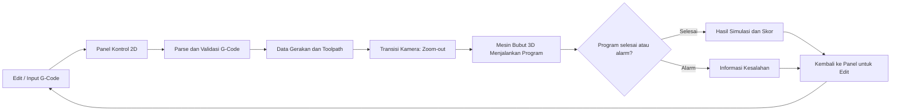
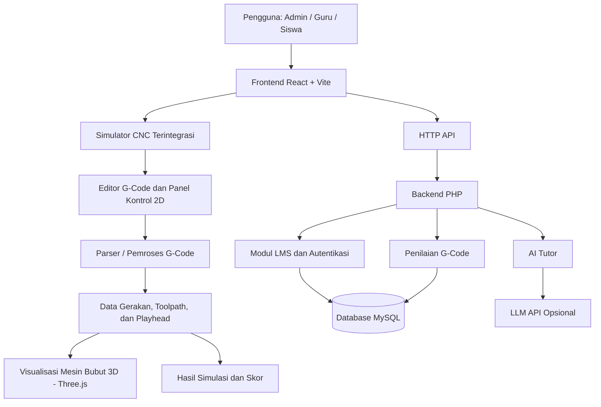

# SiNC — LMS Simulator Bubut CNC

<p align="center">
  <strong>Belajar Pemrograman CNC melalui Simulasi Interaktif dan Pendampingan Digital</strong>
  <br />
  <em>Platform pembelajaran berbasis web untuk membantu siswa memahami G-Code bubut CNC secara visual, bertahap, dan terukur.</em>
</p>

<p align="center">
  
  
  
  
  
</p>

---

## 1. Tentang SiNC

**SiNC (Simulator CNC)** adalah platform Learning Management System (LMS) yang mengintegrasikan simulator bubut CNC dengan aktivitas pembelajaran. Aplikasi ini ditujukan sebagai media pendukung pembelajaran pemrograman CNC, khususnya pengenalan dan latihan G-Code bubut.

Dalam pembelajaran konvensional, pemahaman lintasan pahat, koordinat, dan hasil pembubutan dapat sulit dibayangkan apabila siswa hanya mempelajari kode melalui teks atau gambar dua dimensi. SiNC menghadirkan simulasi visual agar siswa dapat mengamati pergerakan pahat dan perubahan profil benda kerja sebelum menginterpretasikan hasil program.

SiNC dikembangkan dalam konteks **pendidikan (Smart & Fun Education)**. Fokus MVP adalah menghubungkan materi, latihan, simulasi, umpan balik, dan penilaian dalam satu alur pembelajaran.

## 2. Permasalahan dan Solusi

### Permasalahan

- G-Code memiliki sintaks dan sistem koordinat yang perlu dipahami secara bertahap.
- Hubungan antara baris program, gerakan pahat, dan bentuk akhir benda kerja tidak selalu mudah divisualisasikan.
- Latihan pemrograman perlu disertai umpan balik agar siswa dapat mengetahui kesalahan dasar dan memperbaiki programnya.
- Guru membutuhkan sarana untuk membagikan materi, membuat tugas, serta memantau hasil latihan siswa.

### Solusi yang ditawarkan

SiNC menggabungkan satu simulator CNC dengan LMS. Tampilan panel kontrol 2D digunakan ketika siswa menyusun atau mengedit G-Code. Ketika program dijalankan, tampilan bertransisi melalui kamera zoom-out menuju visualisasi mesin bubut 3D. Keduanya bukan dua simulator atau pilihan mode yang terpisah, melainkan dua tampilan dalam satu rangkaian simulasi dan menggunakan data gerakan program yang sama. Siswa kemudian dapat melihat hasil simulasi dan mengirimkan latihan. Guru dapat mengelola kelas, materi, tugas, dan penilaian melalui aplikasi yang sama.

## 3. Fitur Utama MVP

| Fitur | Deskripsi |
|---|---|
| Simulator bubut CNC terintegrasi | Satu alur simulasi: siswa menulis dan memeriksa G-Code melalui panel kontrol 2D, lalu saat siklus dijalankan kamera melakukan transisi zoom-out untuk memperlihatkan mesin bubut 3D yang mengeksekusi program. |
| Interpretasi G-Code | Mesin simulasi mendukung perintah dasar `G00`, `G01`, `G02`, `G03`, `G90`, dan `G91`. |
| Deteksi kejadian simulasi | Menampilkan informasi kondisi seperti peringatan, kesalahan lintasan, dan indikasi tabrakan yang dimodelkan oleh simulator. |
| LMS berbasis peran | Memisahkan pengalaman pengguna Admin, Guru, dan Siswa. |
| Manajemen kelas | Guru dapat membuat kelas dan mengelola keanggotaan siswa. |
| Materi pembelajaran | Guru dapat mengelola materi dan berkas pendukung pembelajaran. |
| Tugas dan latihan | Guru dapat menyusun tugas; siswa dapat mengerjakan dan mengirimkan program G-Code. |
| Penilaian | Sistem menyimpan hasil percobaan dan mendukung penilaian guru serta rekap nilai. |
| AI Tutor | Memberikan umpan balik pembelajaran terkait G-Code. Pemeriksaan dasar tetap dapat berjalan secara otomatis; respons LLM tersedia jika konfigurasi layanan AI diisi. |

> **Batasan simulasi:** SiNC merupakan media pembelajaran dan simulasi perangkat lunak. Hasil simulasi tidak boleh dianggap sebagai pengganti verifikasi program, prosedur keselamatan, atau pengujian pada mesin CNC nyata oleh instruktur yang kompeten.

## 4. Alur Penggunaan

1. **Admin** mengelola akun dan data pengguna.
2. **Guru** membuat kelas, membagikan materi, dan menyusun tugas latihan.
3. **Siswa** bergabung ke kelas, mempelajari materi, dan membuka simulator.
4. **Siswa menyusun G-Code** melalui editor yang terintegrasi dengan panel kontrol CNC 2D.
5. **Sistem memproses G-Code** menjadi data gerakan pahat, lintasan, dan profil benda kerja.
6. **Siswa menjalankan siklus.** Kamera bergerak zoom-out dari panel kontrol sehingga mesin bubut 3D terlihat dan proses pemotongan divisualisasikan sampai program selesai atau terjadi kondisi alarm.
7. **Sistem menampilkan hasil** berupa status simulasi, informasi kesalahan/peringatan, dan skor sesuai aturan penilaian yang diterapkan.
8. **Siswa mengirimkan pekerjaan** untuk dinilai, kemudian **guru** memeriksa hasil, memberikan catatan, dan memantau rekap pembelajaran.

### Satu simulator, dua tampilan yang berurutan

Panel 2D dan mesin 3D bukan dua mode simulator yang berdiri sendiri. Panel 2D merupakan tampilan saat pengguna menyusun atau mengedit program. Ketika siklus dijalankan, antarmuka bertransisi ke tampilan mesin 3D. Data hasil pemrosesan G-Code dan posisi playback yang sama menjadi acuan visualisasi, sehingga gerakan pahat pada mesin 3D merepresentasikan program yang sedang dijalankan.



## 5. Dokumentasi Visual

### Acuan dan Referensi Perancangan Mesin & Kontroler

Proses perancangan tata letak tombol operasi, kinematika mesin, dan visual kabin didasarkan pada referensi mesin bubut CNC industri nyata:

| Objek | Berkas Referensi | Keterangan |
|---|---|---|
| **Panel Kontrol 2D** | [referensi control panel cnc.jpeg](docs/images/references/referensi%20control%20panel%20cnc.jpeg) | Acuan tata letak tombol operasi, cycle start, emergency stop, dan dial feedrate. |
| **Mesin Bubut 3D** | [referensi mesin cnc gremat sth6166.webp](docs/images/references/referensi%20mesin%20cnc%20gremat%20sth6166.webp) | Acuan pemodelan 3D mesin bubut CNC Gremat STH6166 (spindle, bed, turret, tailstock). |

Detail catatan atribusi dapat dilihat pada [docs/images/references/references.md](docs/images/references/references.md).

*(Tangkapan layar antarmuka aplikasi terbaru dan diagram alur sistem web dapat diperbarui pada direktori `docs/images/screenshots/` dan `docs/images/diagrams/`).*

## 6. Teknologi

| Bagian | Teknologi |
|---|---|
| Frontend | React 18, JavaScript, HTML, CSS |
| Build tool | Vite |
| Visualisasi 3D | Three.js |
| Backend | PHP Native |
| Database | MySQL |
| API | REST-style JSON API |
| Autentikasi | Token Bearer/JWT dengan konfigurasi secret melalui environment variable |
| AI Tutor | Integrasi endpoint LLM yang kompatibel dengan format API OpenAI; bersifat opsional melalui konfigurasi |

## 7. Arsitektur Sistem



Frontend mengelola alur interaksi dan satu pengalaman simulator. Panel kontrol 2D digunakan pada tahap penyusunan program; saat siklus dijalankan, kamera bertransisi untuk menampilkan mesin 3D. Kedua tampilan mengikuti hasil pemrosesan G-Code dan posisi playback yang sama, bukan menjalankan dua mesin simulasi terpisah. Backend PHP menyediakan endpoint autentikasi, pengelolaan LMS, penyimpanan hasil, penilaian, dan AI Tutor. Data aplikasi disimpan pada MySQL. Integrasi LLM bersifat opsional dan memerlukan konfigurasi kredensial pada server.

## 8. Struktur Direktori

```text
SiNC/
├── backend-php/                  # Backend API berbasis PHP
│   ├── lib/                      # Logika inti aplikasi
│   │   ├── AITutor.php           # Umpan balik dan integrasi AI Tutor
│   │   ├── GCode.php             # Parser dan mesin simulasi G-Code
│   │   └── Lms.php               # Fungsi pendukung LMS
│   ├── routes/                   # Endpoint API per fitur
│   ├── tests/                    # Pengujian backend dan API
│   ├── uploads/                  # Penyimpanan berkas yang diunggah
│   ├── api.php                   # Front controller API
│   ├── config.php                # Konfigurasi aplikasi
│   ├── database.sql              # Skema dan data awal database
│   └── .env.example              # Contoh variabel environment
│
├── lms-cnc-client/               # Frontend React + Vite
│   ├── public/                   # Aset publik (jika digunakan)
│   ├── src/
│   │   ├── assets/               # Logo dan aset visual frontend
│   │   ├── components/           # Komponen simulator dan UI
│   │   ├── examples/             # Contoh implementasi
│   │   ├── pages/                # Halaman Admin, Guru, Siswa, dan bersama
│   │   ├── three/                # Scene, mesin, pahat, benda kerja, toolpath
│   │   ├── ui/                   # Komponen UI dasar dan hooks
│   │   ├── api.js                # Komunikasi frontend dengan backend
│   │   ├── App.jsx               # Komponen aplikasi utama
│   │   ├── router.jsx            # Konfigurasi routing
│   │   └── styles.css            # Style global
│   ├── index.html
│   ├── package.json
│   ├── vite.config.js
│   └── .env.example
│
├── docs/                         # Dokumentasi teknis dan visual
│   ├── API-LMS.md                # Dokumentasi endpoint API
│   ├── images/
│   │   ├── screenshots/          # Tampilan aplikasi saat berjalan
│   │   ├── diagrams/             # Diagram arsitektur, alur, UML, dan ERD
│   │   └── references/           # Gambar referensi desain beserta atribusi
│   │       ├── referensi control panel cnc.jpeg
│   │       ├── referensi mesin cnc gremat sth6166.webp
│   │       └── references.md
│
├── deploy/                       # Script dan panduan deployment
│   ├── build-cpanel.sh
│   ├── public_html.htaccess
│   ├── README.md
│   └── sql/                      # Script migrasi database
│
├── .gitignore
└── README.md                     # Dokumentasi utama proyek
```

> Direktori `node_modules/`, `dist/`, `.git/`, dan hasil build/deployment seperti `cPanel/` tidak perlu dicantumkan sebagai source utama. Jangan mengunggah kredensial atau hasil build yang berisi konfigurasi rahasia.

## 9. Menjalankan Aplikasi secara Lokal

### Prasyarat

- PHP 8.1 atau lebih baru dengan ekstensi PDO MySQL.
- MySQL atau MariaDB.
- Node.js dan npm.
- Browser modern.

### 9.1 Clone repository

```bash
git clone https://github.com/FataFavian/SiNC.git
cd SiNC
```

### 9.2 Siapkan database

1. Jalankan MySQL melalui XAMPP atau layanan database lokal.
2. Buat database bernama `cnc_lms`.
3. Import `backend-php/database.sql` melalui phpMyAdmin atau MySQL CLI.

### 9.3 Konfigurasi backend

Masuk ke direktori backend:

```bash
cd backend-php
```

Salin `.env.example` menjadi `.env`, lalu sesuaikan konfigurasi database dan secret lokal. Jangan mengisi nilai rahasia asli ke `.env.example` dan jangan commit file `.env`.

Contoh variabel yang perlu disesuaikan:

```env
DB_HOST=127.0.0.1
DB_NAME=cnc_lms
DB_USER=root
DB_PASS=
CLIENT_URL=http://localhost:5173
JWT_SECRET=ganti-dengan-secret-lokal
APP_DEBUG=1
LLM_API_URL=https://api.openai.com/v1/chat/completions
LLM_API_KEY=
LLM_MODEL=gpt-4o-mini
```

Jalankan backend:

```bash
php -S 127.0.0.1:8000 api.php
```

### 9.4 Konfigurasi dan jalankan frontend

Buka terminal baru:

```bash
cd lms-cnc-client
npm install
npm run dev
```

Buka alamat yang ditampilkan Vite, umumnya:

```text
http://localhost:5173
```

Aplikasi juga dapat langsung mencoba simulator mesin 3D tanpa login melalui:
```text
http://localhost:5173/?demo=3d
```

## 10. Atribusi dan Referensi

Seluruh aset, pustaka, API, model, dataset, template, dan materi pihak ketiga yang digunakan dalam produk harus dicantumkan secara transparan.

| Jenis | Nama/Sumber | Bagian yang digunakan | Lisensi/URL |
|---|---|---|---|
| Library frontend | React | Antarmuka aplikasi | https://react.dev/ |
| Build tool | Vite | Pengembangan dan build frontend | https://vite.dev/ |
| Library 3D | Three.js | Visualisasi simulator 3D | https://threejs.org/ |
| Backend | PHP | API dan logika aplikasi | https://www.php.net/ |
| Database | MySQL | Penyimpanan data aplikasi | https://www.mysql.com/ |
| Referensi panel CNC | Gremat CNC Panel Reference | Acuan perancangan panel 2D | [Lihat dokumentasi referensi](docs/images/references/references.md) |
| Referensi mesin CNC | Gremat STH6166 CNC Lathe | Acuan pemodelan mesin 3D | [Lihat dokumentasi referensi](docs/images/references/references.md) |

Jika menggunakan layanan AI, tuliskan nama layanan/model, tujuan penggunaan, dan bagian aplikasi yang memanfaatkannya. Pada implementasi ini, AI Tutor memiliki pemeriksaan G-Code otomatis di sisi aplikasi dan dapat menggunakan LLM eksternal apabila `LLM_API_URL`, `LLM_API_KEY`, serta `LLM_MODEL` dikonfigurasi. Jangan mencantumkan API key atau token pada README maupun repository.

## 11. Pengujian

Folder `backend-php/tests/` berisi skrip pengujian yang tersedia di repository. Jalankan pengujian sesuai kebutuhan dan lingkungan lokal.

Contoh pengujian mesin G-Code:

```bash
php backend-php/tests/test-engine.php
```

## 12. Batasan dan Pengembangan Lanjutan

SiNC berfokus pada pembelajaran dan simulasi dasar bubut CNC. Cakupan perintah G-Code yang didukung simulator saat ini terbatas pada perintah yang dijelaskan pada bagian fitur. Perilaku mesin CNC industri dapat berbeda menurut kontroler, parameter mesin, tool offset, material, dan konfigurasi aktual.

Pengembangan lanjutan dapat mencakup perluasan cakupan G-Code, peningkatan validasi lintasan, pengayaan modul pembelajaran, analitik perkembangan siswa, dan penyempurnaan pengalaman guru dalam memberikan umpan balik.

## 13. Tim Pengembang

| Peran | Nama |
|---|---|
| Pengembang | **Tambahkan nama anggota tim resmi** |
| Institusi | **Tambahkan institusi** |
| Kontak | **Tambahkan email/tautan kontak tim** |

## 14. Informasi Kompetisi

Proyek ini disiapkan untuk mengikuti **LOGICODIX 2026 – Hackathon Competition** dengan tema besar:

> **NextGen Digital Innovation: Crafting Creative Solutions for a Better Society**

Subtema yang relevan: **Smart & Fun Education**.

---

<p align="center">
  <strong>SiNC — Learn G-Code. Visualize the Process. Understand CNC.</strong>
</p>
