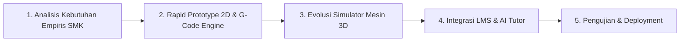
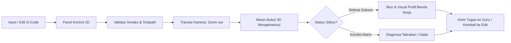
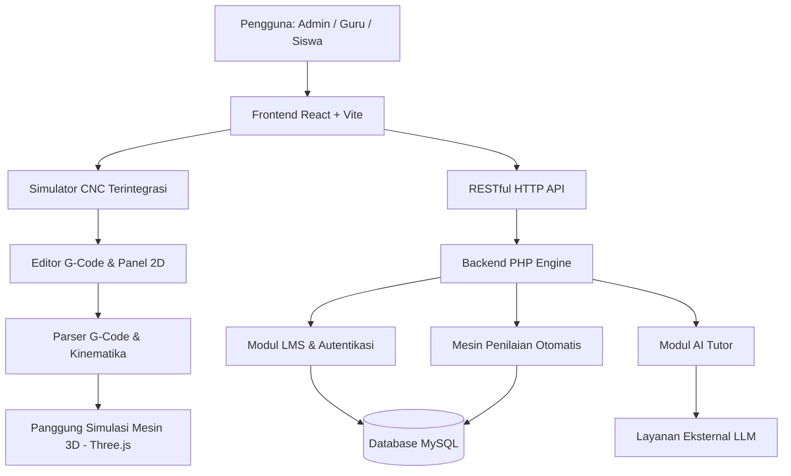

# SiNC — LMS Simulator Bubut CNC

<p align="center">
  <strong>Belajar Pemrograman CNC melalui Simulasi Interaktif dan Pendampingan Digital</strong>
  <br />
  <em>Platform pembelajaran berbasis web untuk membantu siswa memahami G-Code bubut CNC secara visual, bertahap, dan terukur.</em>
</p>

<p align="center">
  
  
  
  
  
</p>

---

## 1. Tentang SiNC

**SiNC (Simulator CNC)** adalah platform Learning Management System (LMS) terpadu yang mengintegrasikan simulator bubut CNC interaktif dengan aktivitas pembelajaran vokasi. Aplikasi ini dirancang sebagai jembatan praktis dalam pembelajaran pemrograman CNC, khususnya pengenalan, perancangan, dan verifikasi kode G-Code mesin bubut.

SiNC dikembangkan dalam rangka kompetisi **LOGICODIX 2026** dengan subtema **Smart & Fun Education**, berfokus pada penghapusan sekat antara teori di buku teks dan praktik nyata di bengkel permesinan.

---

## 2. Latar Belakang dan Permasalahan

### Latar Belakang Empiris
Gagasan pengembangan SiNC berakar langsung dari pengalaman empiris tim saat menempuh pendidikan di **SMK Jurusan Teknik Pemesinan**. Pada pembelajaran mesin bubut CNC konvensional, sekolah kerap menghadapi keterbatasan sarana fasilitas fisik yang nyata:
- **Kesenjangan Rasio Fasilitas**: Di bengkel sekolah, umumnya hanya tersedia **2 unit mesin bubut CNC fisik untuk melayani sekitar 30 siswa** dalam satu rombongan belajar.
- **Minimnya Waktu Praktik Per Siswa**: Siswa harus bergiliran dengan alokasi waktu yang sangat terbatas. Akibatnya, pembelajaran lebih banyak didominasi teori hafalan dari buku teks tanpa kesempatan eksperimen mandiri.
- **Tingginya Hambatan Psikologis & Biaya**: Pemula sering merasa cemas saat memprogram mesin asli karena kekhawatiran risiko tabrakan (*crash*) pahat yang dapat merusak mesin bernilai ratusan juta rupiah serta membuang-buang benda kerja logam (*raw material*).

### Permasalahan yang Dihadapi
1. Sintaks G-Code dan sistem koordinat kartesius (sumbu X dan Z) bersifat abstrak dan sulit dibayangkan tanpa umpan balik visual seketika.
2. Tidak tersedianya media simulasi yang terintegrasi langsung dengan platform tugas dan penilaian guru dalam satu pintu.
3. Keterbatasan akses siswa untuk berlatih mandiri di luar jam operasional bengkel sekolah.

### Solusi yang Ditawarkan
SiNC menghadirkan satu ekosistem terpadu: **LMS + Simulator CNC**. Siswa dapat menulis program pada panel kontrol 2D, lalu saat siklus pemotongan dijalankan, antarmuka bertransisi mulus (*cinematic zoom-out*) memperlihatkan mesin bubut 3D yang memotong benda kerja secara real-time. Siswa mendapatkan pemahaman spasial yang konkret tanpa risiko kerusakan fisik, dan guru dapat memantau penugasan serta rekap nilai secara otomatis.

---

## 3. Relevansi dengan Sustainable Development Goals (SDGs)

Sejalan dengan tema besar *NextGen Digital Innovation: Crafting Creative Solutions for a Better Society*, SiNC memberikan kontribusi nyata terhadap target pembangunan berkelanjutan:

| Tujuan SDG | Target Relevan | Kontribusi Nyata SiNC |
|---|---|---|
| **SDG 4: Quality Education** | **Target 4.4** (Peningkatan Keterampilan Vokasi & Kesiapan Kerja) | Mendemokratisasi akses pelatihan CNC berkualitas bagi seluruh siswa SMK tanpa terkendala keterbatasan jumlah mesin fisik sekolah. |
| **SDG 9: Industry, Innovation, and Infrastructure** | **Target 9.2 & 9.4** (Modernisasi Industri & Keterampilan Manufaktur) | Mempersiapkan talenta muda operator dan programmer mesin presisi untuk menyongsong era *Industry 4.0* dan *Smart Manufacturing*. |
| **SDG 12: Responsible Consumption and Production** | **Target 12.2 & 12.5** (Pencegahan Limbah & Efisiensi Energi) | Pembelajaran ramah lingkungan (*Green Education*): menghemat bahan baku logam mentah, meniadakan limbah gram saat tahap awal latihan, dan menghemat konsumsi energi listrik bengkel. |

---

## 4. Metodologi Pengembangan (SDLC)

SiNC dikembangkan menggunakan metodologi **Agile Prototyping Model (Iterative Development)**, yang memungkinkan pengujian dan penyempurnaan fitur secara berkelanjutan:



1. **Analisis Kebutuhan Empiris (Empirical Analysis)**: Pengumpulan masalah nyata pembelajaran bubut CNC di SMK (rasio mesin 2:30 siswa, kesulitan koordinat X/Z).
2. **Rapid Prototyping (PoC 2D)**: Membangun purwarupa awal berupa panel kontrol 2D dan *parser G-Code* untuk memverifikasi validitas logika pergerakan pahat sebelum pemodelan kompleks.
3. **Evolusi Simulasi 3D (Spatial Evolution)**: Mentransformasikan engine simulasi ke representasi visual mesin 3D interaktif menggunakan **Three.js**, mencakup eretan, kepala lepas (*tailstock*), pencekam (*chuck*), cairan pendingin (*coolant*), dan serpihan geram (*sparks*).
4. **Integrasi Ekosistem LMS & AI (System Integration)**: Mengintegrasikan peran pengguna (Admin, Guru, Siswa), modul materi, tugas praktik, evaluasi otomatis, serta asisten cerdas **AI Tutor** untuk memberikan panduan perbaikan sintaks.
5. **Pengujian & Deployment (Testing & Release)**: Pengujian unit logika mesin (`test-engine.php`), penyederhanaan akses login manual & demo instan, serta penyiapan deployment cPanel.

---

## 5. Fitur Utama MVP

| Fitur | Deskripsi |
|---|---|
| Simulator CNC Terintegrasi | Satu alur simulasi berkesinambungan: menyusun G-Code pada panel kontrol 2D, lalu saat tombol *Cycle Start* ditekan, kamera bertransisi *zoom-out* memperlihatkan mesin bubut 3D yang mengeksekusi program. |
| Interpretasi Perintah G-Code | Mendukung perintah dasar permesinan bubut: `G00` (rapid positioning), `G01` (linear feed), `G02` & `G03` (circular interpolation), serta mode koordinat `G90` (absolut) dan `G91` (inkremental). |
| Deteksi Alarm & Pencegahan Crash | Mendeteksi tabrakan pahat dengan material mentah atau rahang chuck saat gerak cepat (`G00`), serta menghentikan siklus seketika disertai diagnosa kesalahan. |
| LMS Berbasis Peran | Memisahkan hak akses dan fungsionalitas antara **Admin**, **Guru**, dan **Siswa**. |
| Manajemen Kelas & Penugasan | Guru dapat membuat rombel kelas, membagikan kode gabung, menyusun tugas pemrograman, dan menerbitkan kuis teori. |
| Evaluasi Otomatis & Rekap Nilai | Sistem menilai hasil simulasi program siswa secara otomatis (0-100) dan guru dapat memberikan catatan serta mengunduh rekap nilai. |
| AI Tutor Pendamping | Menyediakan asistensi pembelajaran interaktif untuk membimbing siswa saat menemukan galat (*error*) sintaks atau logika pada program G-Code. |

---

## 6. Alur Penggunaan



---

## 7. Desain & Dokumentasi Visual

### Acuan dan Referensi Perancangan Mesin & Kontroler

Perancangan tata letak tombol operasi, kinematika mesin, dan estetika visual didasarkan pada referensi mesin bubut CNC industri nyata:

| Komponen | Berkas Referensi | Sumber Acuan & Deskripsi |
|---|---|---|
| **Panel Kontrol 2D** | [referensi control panel cnc.jpeg](docs/images/references/referensi%20control%20panel%20cnc.jpeg) | Tata letak standar industri: tombol mode (EDIT, AUTO, JOG, MDI), cycle start/stop, feedrate override, dan koordinat digital X/Z. |
| **Mesin Bubut 3D** | [referensi mesin cnc gremat sth6166.webp](docs/images/references/referensi%20mesin%20cnc%20gremat%20sth6166.webp) | Pemodelan 3D mesin bubut CNC **Gremat STH6166** (mesin yang digunakan pada bengkel SMK acuan). Mencakup headstock, bed, carriage, tool turret, dan kabin pelindung. |

Detail dokumentasi dan atribusi lengkap tersedia pada berkas [docs/images/references/references.md](docs/images/references/references.md).

### Konsep Desain Antarmuka (*Liquid Glass Aesthetics*)
Antarmuka pengguna mengadopsi estetika *modern liquid glass* dengan proporsi palet warna terukur:
- **60% Navy Deep**: Memberikan fokus visual, kontras tinggi, dan kenyamanan ergonomis di layar kerja (*dark workspace*).
- **30% Cream Slate**: Sebagai bidang kontainer panel kontrol, tipografi sekunder, dan pembatas konten yang lembut.
- **10% Coral Accent**: Menyorot elemen aksi utama (*Call to Action*), indikator status aktif mesin, dan tombol darurat.

---

## 8. Teknologi

| Bagian | Teknologi | Keterangan |
|---|---|---|
| Frontend | React 18, JavaScript (ES6+), HTML5, CSS3 | Antarmuka pengguna dan state management |
| Build Tool | Vite | Bundling cepat dan Hot Module Replacement (HMR) |
| Visualisasi 3D | Three.js | Grafika WebGL mesin bubut, partikel geram, dan cairan pendingin |
| Backend | PHP Native (PHP 8.1+) | REST API modular, autentikasi JWT token |
| Database | MySQL / MariaDB | Penyimpanan relasional (11 tabel) |
| AI Tutor | Integrasi API LLM (OpenAI-compatible) | Layanan opsional untuk asistensi cerdas |

---

## 9. Arsitektur Sistem



---

## 10. Struktur Direktori

```text
SiNC/
├── backend-php/                  # Backend API berbasis PHP
│   ├── lib/                      # Logika inti aplikasi (GCode, Lms, AITutor)
│   ├── routes/                   # Endpoint modular per entitas (auth, kelas, tugas, dll.)
│   ├── tests/                    # Skrip pengujian otomatis backend
│   ├── uploads/                  # Media dan berkas materi pembelajaran
│   ├── api.php                   # Front controller API
│   ├── config.php                # Konfigurasi aplikasi & koneksi database
│   ├── database.sql              # Skema awal database
│   └── .env.example              # Contoh variabel lingkungan
│
├── lms-cnc-client/               # Frontend aplikasi React + Vite
│   ├── src/
│   │   ├── assets/               # Logo, maskot AI, dan ikon grafis
│   │   ├── components/           # Komponen kontroler 2D, simulator 3D, dan bot widget
│   │   ├── pages/                # Halaman berbasis peran (Admin, Guru, Siswa, Profil)
│   │   ├── three/                # Scene 3D, kinematika mesin, coolant, sparks, workpiece
│   │   ├── ui/                   # Komponen primitif sistem desain (Button, Modal, Input)
│   │   ├── api.js                # Klien HTTP komunikasi backend
│   │   ├── App.jsx               # Komponen routing dan layout utama
│   │   └── styles.css            # Desain global liquid glass
│   ├── index.html
│   ├── package.json
│   └── vite.config.js
│
├── docs/                         # Dokumentasi teknis dan visual
│   ├── API-LMS.md                # Spesifikasi lengkap endpoint REST API
│   ├── images/
│   │   ├── screenshots/          # Tangkapan layar antarmuka aplikasi
│   │   ├── diagrams/             # Diagram arsitektur dan alur sistem
│   │   └── references/           # Gambar referensi mesin fisik & kontroler
│   │       ├── referensi control panel cnc.jpeg
│   │       ├── referensi mesin cnc gremat sth6166.webp
│   │       └── references.md     # Dokumen atribusi dan sumber referensi
│
├── deploy/                       # Skrip build dan petunjuk deployment cPanel
├── .gitignore
└── README.md                     # Dokumentasi utama proyek
```

---

## 11. Menjalankan Aplikasi secara Lokal

### Prasyarat
- PHP 8.1 atau lebih baru (dengan ekstensi `pdo_mysql`)
- MySQL atau MariaDB
- Node.js (v18+) dan npm
- Browser modern dengan dukungan WebGL

### Langkah Instalasi

1. **Clone Repository**:
   ```bash
   git clone https://github.com/FataFavian/SiNC.git
   cd SiNC
   ```

2. **Siapkan Basis Data**:
   - Buat database baru bernama `cnc_lms` pada MySQL lokal Anda.
   - Impor skema dari file `backend-php/database.sql`.

3. **Jalankan Backend**:
   ```bash
   cd backend-php
   cp .env.example .env
   # Sesuaikan DB_NAME, DB_USER, DB_PASS pada file .env
   php -S 127.0.0.1:8000 api.php
   ```

4. **Jalankan Frontend**:
   Buka terminal baru:
   ```bash
   cd lms-cnc-client
   npm install
   npm run dev
   ```
   Akses aplikasi melalui peramban di `http://localhost:5173`.  
   *(Mode coba simulator 3D instan tanpa login dapat langsung diakses melalui `http://localhost:5173/?demo=3d`)*.

---

## 12. Atribusi, Hak Cipta, dan Transparansi AI

### Atribusi Hak Cipta Mesin Acuan
- Nama merek dan desain fisik mesin bubut **Gremat STH6166** merupakan hak kekayaan intelektual dari produsen terkait.
- Pemodelan digital dan visualisasi dalam proyek ini digunakan secara wajar (*fair use*) murni sebagai media pembelajaran edukasi non-komersial bagi siswa kejuruan.

### Pernyataan Transparansi Kecerdasan Artifisial (AI Disclosure)
Sesuai dengan komitmen orisinalitas dan etika kompetisi:
1. **Orisinalitas Gagasan & Keputusan Desain (Human-Led)**:  
   Gagasan inti, analisis kebutuhan empiris di SMK, alur integrasi LMS-Simulator, penentuan mesin acuan Gremat, serta aturan desain visual (*liquid glass* 60:30:10) merupakan **100% hasil pemikiran dan keputusan orisinal tim pengembang**.
2. **Pemanfaatan AI Sebagai Alat Bantu (AI Pair Programmer)**:  
   Kecerdasan artifisial (Google Antigravity / Gemini) dimanfaatkan secara etis sebagai asisten pemrograman untuk membantu efisiensi penulisan sintaks Three.js, implementasi styling CSS, serta integrasi modul AI Tutor di dalam aplikasi.

---

## 13. Batasan dan Rencana Pengembangan (Roadmap)

### Batasan MVP Saat Ini
- Simulator berfokus pada **Mesin Bubut CNC 2-Sumbu (2-Axis Lathe)** pada bidang X dan Z.
- Perintah G-Code didesain untuk cakupan silindris dasar (`G00, G01, G02, G03, G90, G91`).

### Rencana Tindak Lanjut Pasca-Kompetisi
1. **Ekspansi ke Mesin Frais CNC (3-Axis CNC Milling)**:  
   Mengembangkan modul simulator mesin frais 3-sumbu (X, Y, Z) untuk mendukung pembelajaran operasi *facing*, pembuatan kantung (*pocketing*), dan kontur permukaan 3D.
2. **Penambahan Siklus Pemotongan Otomatis (*Canned Cycles*)**:  
   Mendukung siklus pembubutan berulang seperti `G71` (roughing cycle), `G70` (finishing cycle), dan `G76` (threading cycle).
3. **Analitik Kemajuan Belajar Siswa**:  
   Dashboard diagnostik komprehensif untuk guru dalam mendeteksi pola kesalahan G-Code yang paling sering dialami siswa.

---

## 14. Tim Pengembang (Development Team)

| Nama Anggota | Akun GitHub | Peran & Tanggung Jawab Utama |
|---|---|---|
| **Fata Favian** | [@FataFavian](https://github.com/FataFavian) | Project Lead, Fullstack Architecture & 3D Lathe Simulator Engine |
| **Farrell Ahmed Dimitrie Dhiaul Aulia** | [@meddmt2018](https://github.com/meddmt2018) | UI/UX Designer, Frontend Interface & Liquid Glass Styling |
| **Amri** | [@Nyamukgila24](https://github.com/Nyamukgila24) | Backend Engineer, Database Schema & Scoring Logic |
| **Fazrin Mauza** | [@zrinfa](https://github.com/zrinfa) | Vocational Curriculum Specialist, Quality Assurance & Engine Verification |

---

## 15. Informasi Kompetisi

Proyek ini diajukan untuk mengikuti **LOGICODIX 2026 – Hackathon Competition**:

> **Tema Besar**: *NextGen Digital Innovation: Crafting Creative Solutions for a Better Society*  
> **Subtema**: *Smart & Fun Education*  
> **Institusi**: Tim Pengembang Mahasiswa / Vokasi Indonesia  

---

<p align="center">
  <strong>SiNC — Learn G-Code. Visualize the Process. Understand CNC.</strong>
</p>
