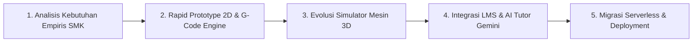
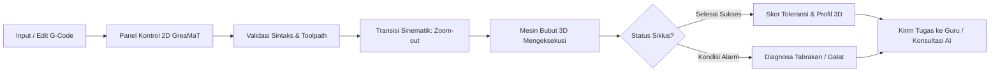
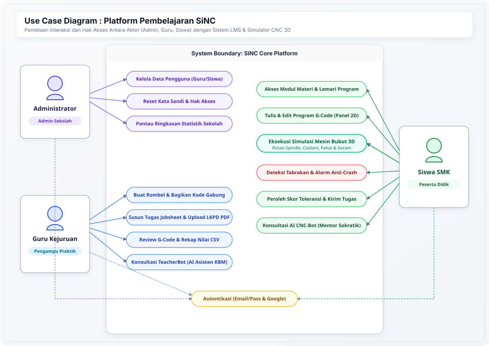
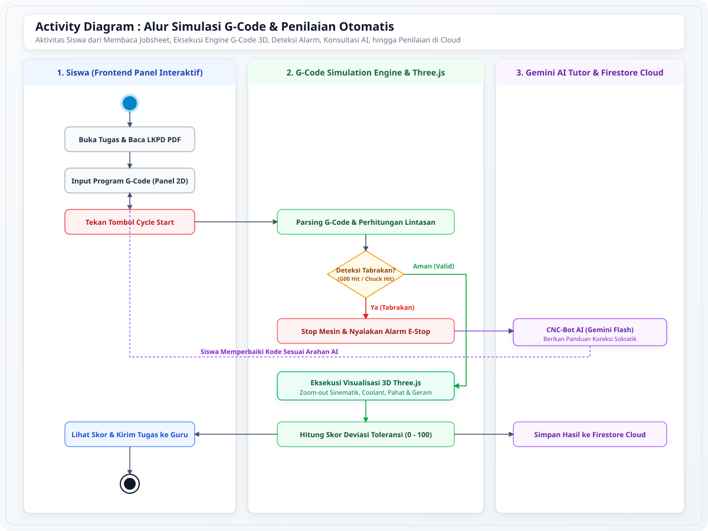
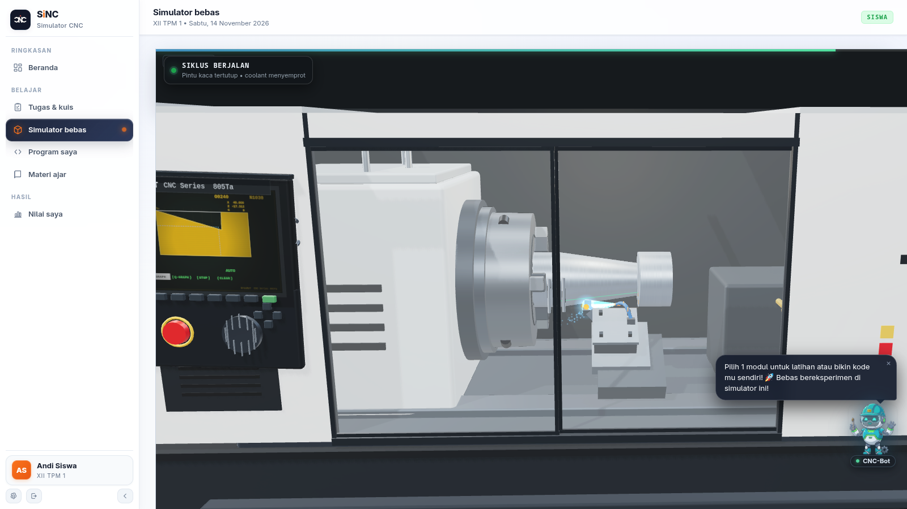
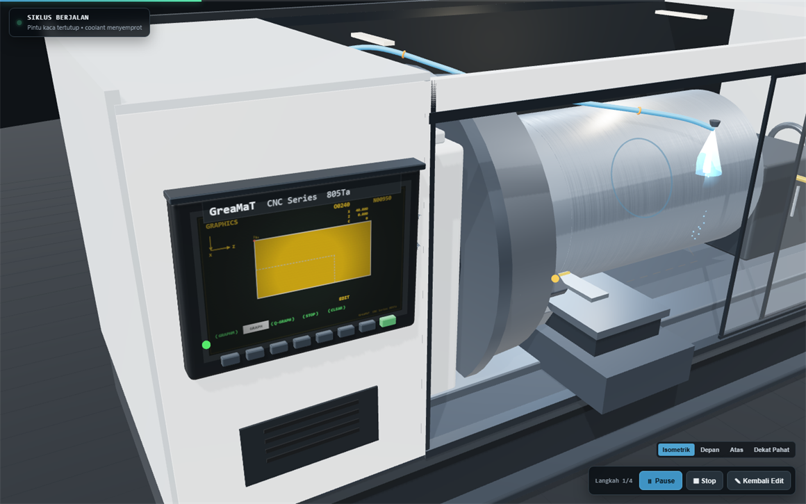
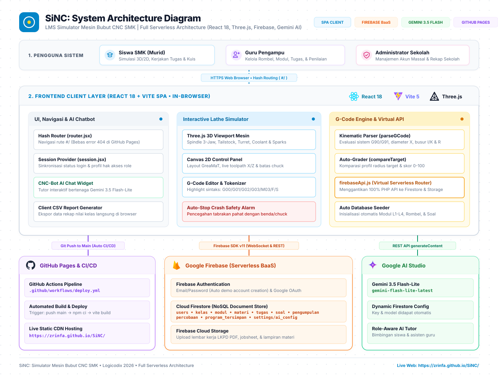
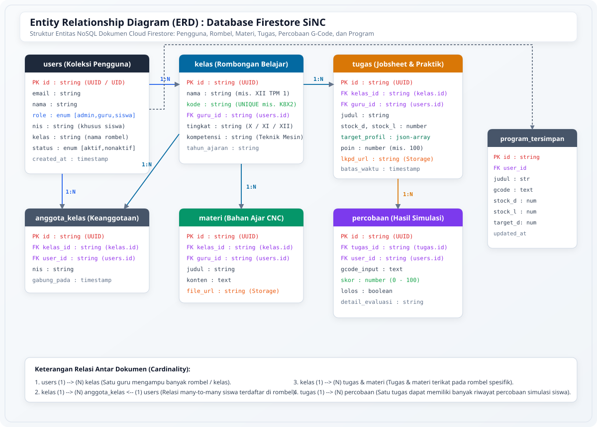

# SiNC: LMS Simulator Bubut CNC

<p align="center">
  <strong>Belajar Pemrograman CNC melalui Simulasi Interaktif dan Pendampingan Digital</strong>
  <br />
  <em>Platform pembelajaran berbasis web untuk membantu siswa memahami G-Code bubut CNC secara visual, bertahap, dan terukur.</em>
</p>

<p align="center">
  
  
  
  
  
  
</p>

Learning Management System (LMS) G-Code untuk SMK berbasis **Full Serverless** yang menggabungkan kelas virtual, simulator mesin bubut CNC 3D interaktif, dan asisten cerdas **Google Gemini AI**.

🌐 **Demo Live Web:** [https://fatafavian.github.io/SiNC/](https://fatafavian.github.io/SiNC/)


---

## 1. Tentang SiNC

**SiNC (Simulator CNC)** adalah platform Learning Management System (LMS) terpadu yang mengintegrasikan simulator bubut CNC interaktif dengan aktivitas pembelajaran vokasi. Aplikasi ini dirancang sebagai jembatan praktis dalam pembelajaran pemrograman CNC, khususnya pengenalan, perancangan, dan verifikasi kode G-Code mesin bubut.

SiNC dikembangkan dalam rangka kompetisi **LOGICODIX 2026** dengan subtema **Smart & Fun Education**, berfokus pada penghapusan sekat antara teori di buku teks dan praktik nyata di bengkel permesinan.

---

## 2. Latar Belakang dan Permasalahan

### Latar Belakang Empiris
Gagasan pengembangan SiNC berakar langsung dari pengalaman empiris tim saat menempuh pendidikan di **SMK Jurusan Teknik Pemesinan**. Pada pembelajaran mesin bubut CNC konvensional, sekolah kerap menghadapi keterbatasan sarana fasilitas fisik yang nyata:
- **Kesenjangan Rasio Fasilitas**: Di bengkel sekolah, umumnya hanya tersedia **2 unit mesin bubut CNC fisik untuk melayani sekitar 30 siswa** dalam satu rombongan belajar.
- **Minimnya Waktu Praktik Per Siswa**: Siswa harus bergiliran dengan alokasi waktu yang sangat terbatas. Akibatnya, pembelajaran lebih banyak didominasi teori hafalan dari buku teks tanpa kesempatan eksperimen mandiri.
- **Tingginya Hambatan Psikologis & Biaya**: Pemula sering merasa cemas saat memprogram mesin asli karena kekhawatiran risiko tabrakan (*crash*) pahat yang dapat merusak mesin bernilai ratusan juta rupiah serta membuang-buang benda kerja logam (*raw material*).

### Permasalahan yang Dihadapi
1. Sintaks G-Code dan sistem koordinat kartesius (sumbu X dan Z) bersifat abstrak dan sulit dibayangkan tanpa umpan balik visual seketika.
2. Tidak tersedianya media simulasi yang terintegrasi langsung dengan platform tugas dan penilaian guru dalam satu pintu.
3. Keterbatasan akses siswa untuk berlatih mandiri di luar jam operasional bengkel sekolah.

### Solusi yang Ditawarkan
SiNC menghadirkan satu ekosistem terpadu: **LMS + Simulator CNC Serverless**. Siswa dapat menulis program pada panel kontrol 2D, lalu saat siklus pemotongan dijalankan, antarmuka bertransisi mulus (*cinematic zoom-out*) memperlihatkan mesin bubut 3D yang memotong benda kerja secara real-time. Siswa mendapatkan pemahaman spasial yang konkret tanpa risiko kerusakan fisik, dan guru dapat memantau penugasan serta rekap nilai secara otomatis.

---

## 3. Relevansi dengan Sustainable Development Goals (SDGs)

Sejalan dengan tema besar *NextGen Digital Innovation: Crafting Creative Solutions for a Better Society*, SiNC memberikan kontribusi nyata terhadap target pembangunan berkelanjutan:

| Tujuan SDG | Target Relevan | Kontribusi Nyata SiNC |
|---|---|---|
| **SDG 4: Quality Education** | **Target 4.4** (Peningkatan Keterampilan Vokasi & Kesiapan Kerja) | Mendemokratisasi akses pelatihan CNC berkualitas bagi seluruh siswa SMK tanpa terkendala keterbatasan jumlah mesin fisik sekolah. |
| **SDG 9: Industry, Innovation, and Infrastructure** | **Target 9.2 & 9.4** (Modernisasi Industri & Keterampilan Manufaktur) | Mempersiapkan talenta muda operator dan programmer mesin presisi untuk menyongsong era *Industry 4.0* dan *Smart Manufacturing*. |
| **SDG 12: Responsible Consumption and Production** | **Target 12.2 & 12.5** (Pencegahan Limbah & Efisiensi Energi) | Pembelajaran ramah lingkungan (*Green Education*): menghemat bahan baku logam mentah, meniadakan limbah gram saat tahap awal latihan, dan menghemat konsumsi energi listrik bengkel. |

---

## 4. Metodologi Pengembangan (SDLC)

SiNC dikembangkan menggunakan metodologi **Agile Prototyping Model (Iterative Development)**, yang memungkinkan pengujian dan penyempurnaan fitur secara berkelanjutan:



1. **Analisis Kebutuhan Empiris (Empirical Analysis)**: Mengidentifikasi hambatan nyata KBM permesinan bubut CNC di SMK, termasuk rasio alat dan kecemasan siswa terhadap tabrakan pahat.
2. **Rapid Prototyping 2D & G-Code Engine**: Merancang parser G-Code berbasis browser dengan validasi tabrakan (rapid collision dan chuck collision) serta kalkulasi profil sayat.
3. **Evolusi Simulator 3D**: Mengembangkan replika 3D mesin bubut acuan industri (Gremat STH6166) menggunakan Three.js lengkap dengan putaran spindle, semprotan coolant, dan efek percikan gram.
4. **Integrasi LMS & AI Tutor**: Menggabungkan manajemen kelas, tugas terstruktur, rekap nilai guru, serta asisten cerdas Google Gemini 3.5 Flash-Lite.
5. **Migrasi Serverless & Deployment**: Mengadopsi arsitektur full serverless (Firebase Auth, Firestore, Storage) dan otomatisasi CI/CD via GitHub Pages.

---

## 5. Fitur Utama & Keunggulan Inovasi

| Fitur | Deskripsi |
|---|---|
| **Simulator CNC Terintegrasi** | Satu alur simulasi berkesinambungan: menyusun G-Code pada panel kontrol 2D, lalu saat tombol *Cycle Start* ditekan, kamera bertransisi *zoom-out* memperlihatkan mesin bubut 3D yang mengeksekusi program secara real-time. |
| **Interpretasi Perintah G-Code Paritas Klien** | Mendukung perintah permesinan bubut: `G00` (rapid positioning), `G01` (linear feed), `G02` & `G03` (circular interpolation), serta mode koordinat `G90` (absolut) dan `G91` (inkremental). Dijalankan langsung di browser siswa tanpa latensi server. |
| **Deteksi Alarm & Anti-Crash Otomatis** | Mendeteksi tabrakan pahat dengan material mentah atau rahang chuck saat gerak cepat (`G00`), diameter negatif, serta menghentikan siklus seketika disertai diagnosa kesalahan. |
| **LMS Serverless Berbasis Peran** | Memisahkan hak akses dan fungsionalitas secara terisolasi antara **Admin**, **Guru**, dan **Siswa** melalui Firebase Authentication dan Firestore Security Rules. |
| **Manajemen Kelas & Penugasan Jobsheet** | Guru dapat membuat rombel kelas dengan kode unik, menyusun penugasan LKPD bertingkat, mengunggah jobsheet PDF ke Firebase Storage, dan membagikan tugas terstruktur. |
| **Evaluasi Otomatis & Rekap Nilai CSV** | Sistem menghitung akurasi dimensi benda kerja hasil eksekusi program siswa secara otomatis (skala 0-100). Guru dapat memberi catatan kualitatif serta mengekspor rekap nilai kelas ke file CSV. |
| **AI CNC-Bot Tutor (Google Gemini)** | Mentor Sokratik interaktif untuk siswa (membimbing perbaikan galat sintaks/logika kode) dan asisten KBM bagi guru dalam penyusunan materi. |
| **Lemari Program Pribadi Siswa** | Ruang penyimpanan program G-Code pribadi di cloud untuk menyimpan draf latihan dan proyek mandiri. |

---

## 6. Alur Penggunaan & Pemodelan Sistem



### 6.1 Use Case Diagram (Interaksi Hak Akses Antara Aktor)
Diagram berikut memetakan pembagian wewenang dan interaksi fungsional antara Administrator, Guru Kejuruan, dan Siswa SMK dalam ekosistem platform SiNC:



### 6.2 Activity Diagram (Alur Eksekusi G-Code & Evaluasi Otomatis)
Diagram aktivitas berikut memvisualisasikan perjalanan komputasi dari saat siswa menginput perintah G-Code pada panel kontrol 2D, validasi tabrakan (rapid collision dan chuck collision), transisi panggung 3D Three.js, bimbingan AI Tutor Sokratik, hingga penilaian toleransi di cloud:



---

## 7. Desain & Dokumentasi Visual

### Acuan dan Referensi Perancangan Mesin & Kontroler

Perancangan tata letak tombol operasi, kinematika mesin, dan estetika visual didasarkan pada referensi mesin bubut CNC industri nyata:

| Komponen | Berkas Referensi | Sumber Acuan & Deskripsi |
|---|---|---|
| **Panel Kontrol 2D** | [referensi control panel cnc.jpeg](docs/images/references/referensi%20control%20panel%20cnc.jpeg) | Tata letak standar kontroler industri GreaMaT: tombol mode (EDIT, AUTO, JOG, MDI), cycle start/stop, feedrate override, dan pembacaan koordinat digital sumbu X dan Z. |
| **Mesin Bubut 3D** | [referensi mesin cnc gremat sth6166.webp](docs/images/references/referensi%20mesin%20cnc%20gremat%20sth6166.webp) | Pemodelan 3D mesin bubut CNC **Gremat STH6166** (mesin yang digunakan pada bengkel SMK acuan). Mencakup headstock, bed, carriage, tool turret, dan kabin pelindung. |

Dokumentasi lengkap foto referensi fisik tersedia pada berkas [docs/images/references/references.md](docs/images/references/references.md).

### Konsep Desain Antarmuka (Liquid Glass Aesthetics)
Antarmuka pengguna mengadopsi estetika *modern liquid glass* dengan proporsi palet warna terukur:
- **60% Navy Deep**: Memberikan fokus visual, kontras tinggi, dan kenyamanan ergonomis di layar simulator kerja (*dark workspace*).
- **30% Cream Slate**: Sebagai bidang kontainer panel kontrol, tipografi sekunder, dan pembatas konten yang lembut.
- **10% Coral Accent**: Menyorot elemen aksi utama (*Call to Action*), indikator status aktif mesin, dan tombol darurat.

### Galeri Tangkapan Layar Simulator 3D




---

## 8. Stack Teknologi

| Komponen | Teknologi | Peran & Keterangan |
|---|---|---|
| **Frontend Framework** | React 18, JavaScript (ES6+), HTML5, CSS3 | Antarmuka pengguna responsif dan modular |
| **Build Toolchain** | Vite 5 | Bundling cepat dan Hot Module Replacement (HMR) |
| **Engine Visualisasi 3D** | Three.js (r186) & Canvas 2D | Visualisasi mesin bubut 3D WebGL, partikel geram, semprotan coolant, dan toolpath |
| **Backend & Cloud Database** | Google Firebase (v11) | Arsitektur Full Serverless bebas biaya server |
| **Autentikasi Pengguna** | Firebase Authentication | Login Email/Password dan Google Sign-In berbasis peran (Admin, Guru, Siswa) |
| **Basis Data Dokumen** | Cloud Firestore | Penyimpanan NoSQL real-time untuk data pengguna, rombel, materi, tugas, dan rekap penilaian |
| **Penyimpanan Berkas** | Firebase Storage | Hosting berkas jobsheet PDF, LKPD, dan media materi ajar |
| **Kecerdasan Artifisial (AI)** | Google Gemini 3.5 Flash-Lite | Chatbot tutor Sokratik (CNC-Bot & TeacherBot) terintegrasi client-side |
| **Hosting & CI/CD** | GitHub Actions & GitHub Pages | Otomatisasi kompilasi dan penyebaran produksi tanpa server fisik |

---

## 9. Arsitektur Serverless Modern

Aplikasi ini telah dimigrasikan dari arsitektur monolitik (PHP + MySQL + cPanel) menjadi **Full Serverless Single Page Application (SPA)** yang modern, ringan, tangguh, scalable, dan bebas biaya pemeliharaan server.



```text
[ Pengguna / Browser Klien ]
        │
        ├── 1. Frontend & Visualisasi
        │      ├── React 18 + Vite 5 (SPA)
        │      ├── Three.js r186 (Mesin Bubut CNC 3D Real-time)
        │      ├── Canvas 2D (Panel Kontrol GreaMaT & Toolpath)
        │      └── Client-side G-Code Simulation Engine
        │
        ├── 2. Hosting & CI/CD
        │      └── GitHub Pages via GitHub Actions (.github/workflows/deploy.yml)
        │
        ├── 3. Cloud Database & Backend
        │      ├── Firebase Authentication (Email/Password & Google Sign-In)
        │      ├── Cloud Firestore (Dokumen Pengguna, Rombel, Materi, Tugas, Nilai)
        │      └── Firebase Storage (Upload PDF LKPD & File Lampiran Materi)
        │
        └── 4. AI & Pembelajaran Cerdas
               └── Google Gemini 3.5 Flash-Lite (Tutor Pintar CNC-Bot)
```

### Keunggulan Arsitektur Serverless:
1. **Zero Server Maintenance**: Bebas dari risiko server down, konfigurasi runtime PHP, manajemen cPanel, maupun penambalan keamanan database MySQL.
2. **Auto CI/CD Deployment**: Setiap perubahan kode yang dipush ke branch `main` langsung diuji, dikompilasi, dan dideploy otomatis oleh GitHub Actions ke GitHub Pages.
3. **Client-Side Simulation Parity**: Seluruh kalkulasi koordinat G-Code, deteksi tabrakan (rapid collision, chuck hit), dan evaluasi toleransi profil dieksekusi 100% di browser tanpa latensi jaringan.
4. **AI Asisten Real-time**: Menggunakan **Google Gemini 3.5 Flash-Lite** secara serverless untuk memberikan bimbingan interaktif kepada siswa dan guru.

### 9.2 Diagram Relasi Entitas Data (Database ERD)
Meskipun menggunakan basis data NoSQL Cloud Firestore, relasi logis antar koleksi dokumen tetap dirancang dengan integritas data referensial yang ketat untuk menjamin keamanan hak akses akademik (*Firestore Security Rules*):



---

## 10. Struktur Direktori Repositori

```text
SiNC/
├── .github/
│   └── workflows/
│       └── deploy.yml          # Otomatisasi build & deploy ke GitHub Pages
├── docs/                       # Dokumentasi arsitektur dan aset visual
│   ├── images/
│   │   ├── diagrams/           # Diagram arsitektur, use case, activity, dan ERD
│   │   │   ├── activity-diagram.svg
│   │   │   ├── database-erd.svg
│   │   │   └── use-case-diagram.svg
│   │   └── references/         # Foto referensi mesin fisik & kontroler acuan
│   │       ├── references.md
│   │       ├── referensi control panel cnc.jpeg
│   │       └── referensi mesin cnc gremat sth6166.webp
│   ├── system-architecture.svg # Diagram arsitektur sistem putih bersih
│   ├── simulator-panel.png     # Cuplikan antarmuka panel kontrol 2D
│   ├── simulator-3d.png        # Cuplikan simulator mesin 3D layar penuh
│   └── simulator-3d-detail.png # Detail pahat, coolant, dan pencekam
├── firestore.rules             # Aturan keamanan database Cloud Firestore
├── storage.rules               # Aturan keamanan akses berkas Firebase Storage
├── lms-cnc-client/             # Aplikasi frontend SPA (React + Three.js)
│   ├── src/
│   │   ├── components/         # Komponen Simulator (3D, 2D, CNC-Bot, Control Panel)
│   │   ├── pages/              # Halaman Siswa, Guru, Admin, Profil, dan Login
│   │   ├── three/              # Scene 3D: mesin, chuck, pahat, coolant, sparks
│   │   ├── ui/                 # Primitif desain sistem dan ikon SVG
│   │   ├── api.js              # G-Code Simulation Engine & Dispatcher
│   │   ├── firebase.js         # Konfigurasi & Inisialisasi Firebase SDK
│   │   ├── firebaseApi.js      # Serverless API Adapter & Integrasi Gemini AI
│   │   ├── router.jsx          # Hash-based SPA Router (GitHub Pages Ready)
│   │   └── session.jsx         # Manajemen sesi autentikasi pengguna
│   ├── package.json
│   └── vite.config.js
├── .gitignore
└── README.md                   # Dokumentasi utama proyek
```

---

## 11. Menjalankan Aplikasi secara Lokal

### Prasyarat
- **Node.js (v18+)** dan **npm**
- Browser modern dengan dukungan **WebGL** (Google Chrome, Microsoft Edge, Mozilla Firefox)

### Langkah Instalasi

1. **Clone Repository**:
   ```bash
   git clone https://github.com/FataFavian/SiNC.git
   cd SiNC
   ```

2. **Masuk ke Direktori Klien & Pasang Dependensi**:
   ```bash
   cd lms-cnc-client
   npm install
   ```

3. **Jalankan Server Pengembangan**:
   ```bash
   npm run dev
   ```

4. **Buka Peramban**:
   Akses aplikasi melalui peramban di `http://localhost:5173`.  
   *(Mode coba simulator 3D instan tanpa login dapat langsung diakses melalui `http://localhost:5173/?demo=3d`)*.

---

## 12. Akun Demo (One-Click Login)

Di halaman login telah disediakan tombol instan untuk mengakses berbagai peran:

| Peran | Akun Demo Email | Kata Sandi | Akses Utama |
|---|---|---|---|
| **Administrator** | `admin@smk.sch.id` | `password123` | Manajemen seluruh pengguna, reset password, statistik KBM |
| **Guru Pengampu** | `guru@smk.sch.id` | `password123` | Buat kelas, susun tugas jobsheet, nilai G-Code, ekspor CSV |
| **Siswa 1 (Andi)** | `andi@murid.sch.id` | `password123` | Kerjakan tugas CNC, simulasi 3D, konsultasi CNC-Bot |
| **Siswa 2 (Sinta)** | `sinta@murid.sch.id` | `password123` | Eksperimen simulator bebas, lemari program mandiri |

---

## 13. Atribusi, Hak Cipta, dan Transparansi AI

### Atribusi Hak Cipta Mesin Acuan
- Nama merek dan desain fisik mesin bubut **Gremat STH6166** merupakan hak kekayaan intelektual dari produsen terkait.
- Pemodelan digital dan visualisasi dalam proyek ini digunakan secara wajar (*fair use*) murni sebagai media pembelajaran edukasi non-komersial bagi siswa kejuruan SMK.

### Pernyataan Transparansi Kecerdasan Artifisial (AI Disclosure)
Sesuai dengan komitmen orisinalitas dan etika kompetisi:
1. **Orisinalitas Gagasan & Keputusan Desain (Human-Led)**:  
   Gagasan inti, analisis kebutuhan empiris di SMK, alur integrasi LMS-Simulator, penentuan mesin acuan Gremat, serta aturan desain visual (*liquid glass* 60:30:10) merupakan **100% hasil pemikiran dan keputusan orisinal tim pengembang**.
2. **Pemanfaatan AI Sebagai Alat Bantu (AI Pair Programmer)**:  
   Kecerdasan artifisial (Google Antigravity / Gemini) dimanfaatkan secara etis sebagai asisten pemrograman untuk membantu efisiensi penulisan sintaks Three.js, implementasi styling CSS, serta integrasi modul AI Tutor di dalam aplikasi.

---

## 14. Batasan dan Rencana Pengembangan (Roadmap)

### Batasan MVP Saat Ini
- Simulator berfokus pada **Mesin Bubut CNC 2-Sumbu (2-Axis Lathe)** pada bidang koordinat X dan Z.
- Perintah G-Code didesain untuk cakupan silindris dasar (`G00, G01, G02, G03, G90, G91`).

### Rencana Tindak Lanjut Pasca-Kompetisi
1. **Ekspansi ke Mesin Frais CNC (3-Axis CNC Milling)**:  
   Mengembangkan modul simulator mesin frais 3-sumbu (X, Y, Z) untuk mendukung pembelajaran operasi *facing*, pembuatan kantung (*pocketing*), dan kontur permukaan 3D.
2. **Penambahan Siklus Pemotongan Otomatis (*Canned Cycles*)**:  
   Mendukung siklus pembubutan berulang seperti `G71` (roughing cycle), `G70` (finishing cycle), dan `G76` (threading cycle).
3. **Analitik Kemajuan Belajar Siswa**:  
   Dashboard diagnostik komprehensif untuk guru dalam mendeteksi pola kesalahan G-Code yang paling sering dialami siswa.

---

## 15. Tim Pengembang (Development Team)

| Nama Anggota | Akun GitHub | Peran & Tanggung Jawab Utama |
|---|---|---|
| **Fata Favian** | [@FataFavian](https://github.com/FataFavian) | Project Lead, Fullstack Architecture & 3D Lathe Simulator Engine |
| **Farrell Ahmed Dimitrie Dhiaul Aulia** | [@meddmt2018](https://github.com/meddmt2018) | UI/UX Designer, Frontend Interface & Liquid Glass Styling |
| **Amri** | [@Nyamukgila24](https://github.com/Nyamukgila24) | Software Engineer, Simulation Logic & Scoring Engine |
| **Fazrin Mauza** | [@zrinfa](https://github.com/zrinfa) | Vocational Curriculum Specialist, Quality Assurance & Engine Verification |

---

## 16. Informasi Kompetisi

Proyek ini diajukan untuk mengikuti **LOGICODIX 2026 - Hackathon Competition**:

> **Tema Besar**: *NextGen Digital Innovation: Crafting Creative Solutions for a Better Society*  
> **Subtema**: *Smart & Fun Education*  
> **Institusi**: Tim Pengembang Mahasiswa / Vokasi Indonesia  

---

<p align="center">
  <strong>SiNC: Learn G-Code. Visualize the Process. Understand CNC.</strong>
</p>
